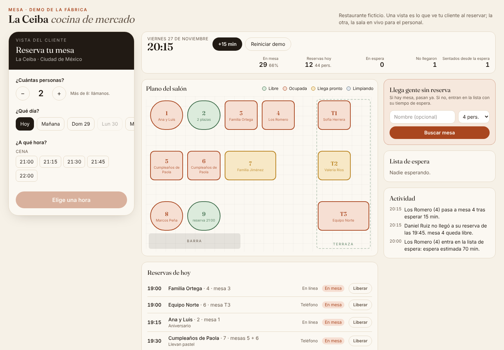

# Mesa · reservas y gestión de mesas para restaurantes

Demo de la Fábrica LatAm. El cliente reserva en línea en 20 segundos y el personal ve el salón en vivo:
qué mesa está ocupada, quién llega en los próximos minutos, quién no se presentó y cuánto tendrá que esperar
la gente que llega sin reserva.



## Probarlo

```bash
npm install
npm run dev        # http://localhost:3000, modo demo sin claves
npm test           # motor, API, seguridad y español neutro
```

La demo arranca el viernes (o el próximo día con cena) a las 20:00, con el salón casi lleno.
El reloj es simulado: el botón **+15 min** lo adelanta.

## Qué hace
- **Reserva en línea**: personas, día y hora. Solo ofrece horas con mesa real libre, respeta la antelación mínima,
  el tope de personas por grupo y el tope de llegadas por intervalo (para no saturar la cocina).
- **Asignación automática**: la mesa más pequeña que sirve; para grupos grandes, une mesas definidas en la configuración.
  Nunca dos reservas en la misma mesa a la vez, con margen de limpieza entre una y otra.
- **Plano del salón en vivo**: libre, ocupada, llega pronto o limpiando. La mesa que cambia se enciende.
- **Ausencias**: pasada la tolerancia (15 min), la reserva se marca como "no se presentó" y la mesa queda libre.
- **Sin reserva y lista de espera**: si hay mesa, pasan ya; si no, entran en la lista con un tiempo estimado que
  simula la cola. Cuando se libera una mesa, la lista se atiende sola.
- **El cliente puede cancelar** su propia reserva con su código.

## Guion del vídeo de 60 segundos
1. (0–10 s) "Viernes, 20:00, salón casi lleno." Se ve el plano con colores.
2. (10–25 s) Desde el móvil, una persona reserva para 2 a las 21:15. La mesa se enciende en el plano.
3. (25–40 s) Llegan 4 personas sin reserva: "Sin mesa ahora. Espera estimada: 70 min".
4. (40–55 s) +15 min: Daniel Ruiz no llegó. El sistema lo marca, libera la mesa 4 y **sienta solo** al grupo, que esperó 15 minutos.
5. (55–60 s) "Ninguna mesa vacía por una reserva que no llega. Mesa, de la Fábrica."

## Adaptarlo a otro restaurante
Solo `src/mesa/config.ts`: mesas (capacidad, mínimo, zona, posición en el plano), uniones posibles,
servicios por día, duración por tamaño de grupo, tolerancia, limpieza y topes.

## Modo real
Con `MESA_TOKEN` (ver `.env.example`) el panel de sala pide clave, el reloj es la hora real del restaurante
y desaparecen el reloj simulado y el reinicio. El almacén sigue en memoria: antes de un cliente real hace falta Supabase (ver `STATUS.md`).

Documentos: [ALCANCE.md](ALCANCE.md) · [AUDITORIA.md](AUDITORIA.md) · [STATUS.md](STATUS.md)
